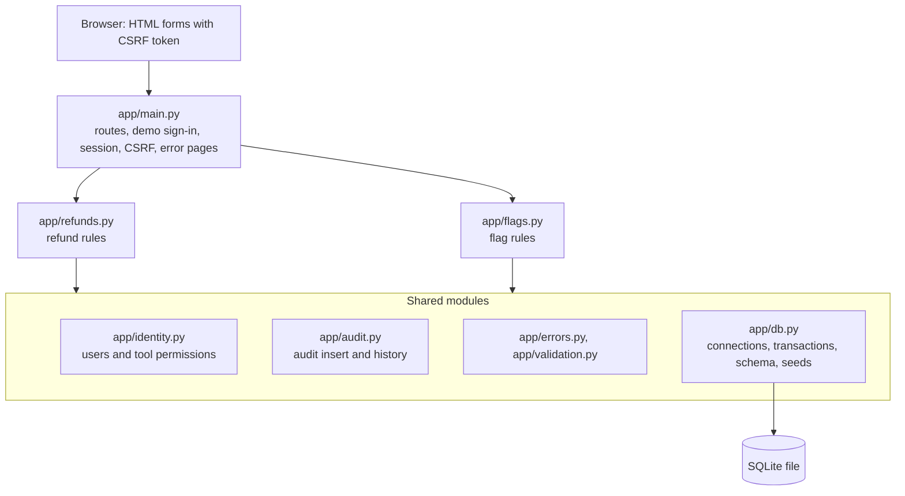

# Cognition Take-Home: Internal tools with Devin

This project explores how a fintech engineering team could use Devin to build internal tools currently served by Power Apps. It includes a refund approval workflow and a sandbox feature-flag panel, built in one application with shared sessions, permission checks, and audit utilities.

Refunds were the main workflow. I added flags to see what could be reused when building another tool.


> Local demo with synthetic data and simulated sign-in. Refund approvals do not move money, and flags do not control a live application.

## What this replicates from Power Apps (and what it doesn't)

Power Apps gives a team (a) a fast way to build forms-over-data apps and (b) a managed platform: Entra ID SSO, connectors, Dataverse, hosting, and admin governance (environments, DLP policies). This prototype shows that Devin can build application workflows like those in (a), while engineers remain responsible for operating them. It does not provide (b).

| Replicated here | Not replicated (on purpose) |
|---|---|
| Forms over data | Connectors |
| Server-side role and permission checks | Dataverse |
| Approval workflow with no self-approval | Citizen-developer building |
| Append-only audit trail (enforced by the app) | Managed hosting |
| Safe concurrent edits | DLP and environment governance |
| | Mobile app |

KYC was deferred because its sensitive data and verification requirements need separate investigation.

There is no generic form builder. Rebuilding the Power Apps builder misses the point because Devin is the builder.

The flags tool added `app/flags.py` (83 lines), 2 tables, 3 routes, 2 templates, and 18 tests. Sessions, CSRF, database helpers, audit, error handling, layout, and test fixtures came from the refund tool. The audit table needed one migration to add a `flag_id` column.

Prototype architecture and possible production changes: [docs/architecture.md](docs/architecture.md).

## Built with Devin

Devin implemented the application, the tests, and the browser checks. I directed the scope, reviewed plans and results, and requested corrections. All changes went through GitHub pull requests with CI.

## Run locally

You need Python 3.10 or newer.

```bash
git clone https://github.com/SohanMads/fintech-internal-tools-poc.git
cd fintech-internal-tools-poc
python3 -m venv .venv
. .venv/bin/activate
pip install -r requirements-dev.txt

export DEMO_MODE=true
export SESSION_SECRET="$(python -c 'import secrets; print(secrets.token_hex(32))')"
uvicorn app.main:create_app --factory --host 127.0.0.1 --port 8000
```

Then open http://127.0.0.1:8000.

`DEMO_MODE=true` enables the demo sign-in page. Without it every page returns 503. `SESSION_SECRET` signs the session cookie, so reuse the same value across restarts to stay signed in.

The app creates and seeds `refunds.db` on first start (override with `DATABASE_PATH`). To reset it, stop the server and run:

```bash
rm -f refunds.db refunds.db-wal refunds.db-shm
```

## Try the workflows

Pick any seeded user on the sign-in page:

| User | Refunds | Sandbox Flags |
|---|---|---|
| Olivia Operator | Submit | View |
| Rita Reviewer | Submit, decide others' requests | View |
| Raj Reviewer | Submit, decide others' requests | View |
| Victor Viewer | View | View |
| Fiona Flag Admin | View | Enable or disable |

### Submit and review a refund

1. As Olivia, open Refunds, choose New refund request, and enter an amount and a reason.
2. Switch to Rita, open the request, and approve or reject it with a reason.

### Competing reviewers

1. As Olivia, submit a new request.
2. Open it as Rita in one browser and as Raj in a private window.
3. Submit a decision in both. The first decision saved wins, and the other reviewer gets a 409 page.

### Change a flag

1. As Fiona, open Sandbox Flags, choose a flag, and enable or disable it with a reason. The change appears in its audit history.
2. Open the same flag in two tabs and save a change in the first. Submitting the older form in the second tab returns 409 with a link to the current state.

## How it works

One FastAPI process renders Jinja2 templates and stores data in one SQLite file.



- **Server-side permissions.** The session identifies the user by ID, and roles and tool permissions are loaded from the database on every request. A `role` or `actor_id` field posted by the browser is ignored.
- **Conditional updates.** A decision runs `UPDATE ... WHERE id = ? AND status = 'pending' AND submitted_by <> ?`, so a second reviewer changes no rows and gets 409. Flag forms carry a version number, and the update only applies if that version is still current.
- **Atomic audit writes.** Each change and its audit row are written in one `BEGIN IMMEDIATE` transaction. If the audit insert fails, the change rolls back.

## Tests

```bash
python -m pytest -q
```

Each of the 87 tests runs against a temporary SQLite database. GitHub Actions runs the same command on every pull request and push to `main`.

| File | Covers |
|---|---|
| `test_permissions.py` | Role rules, 503 without demo mode, ignored client role and actor, CSRF on every form including malformed tokens, GET never mutates, 404s |
| `test_validation.py` | Invalid amounts and blank reasons rejected with no rows written, trimming, status labels |
| `test_decisions_and_audit.py` | Self-approval, sequential and threaded concurrent conflicts, audit consistency, audit-failure rollback, busy-timeout 503, database constraints |
| `test_flags.py` | Only Fiona edits, Fiona cannot submit or decide refunds, reason required, stale form 409 (also when the reason is invalid), audit-failure rollback, audit target CHECK |
| `test_money_and_migration.py` | Exact dollar to cents conversion, rejected formats, refund-only audit table migrated with history preserved |

## Limitations

- Sign-in is simulated, and any user can be impersonated.
- It runs as one local process on SQLite, with no deployment setup.
- The app never edits audit rows, but anyone with access to the database file can.
- Each new audited resource type needs an audit schema change.
- On narrow screens, tables scroll horizontally instead of stacking.

Production use would require identity-provider integration, deployment and operations work, and a security review.
