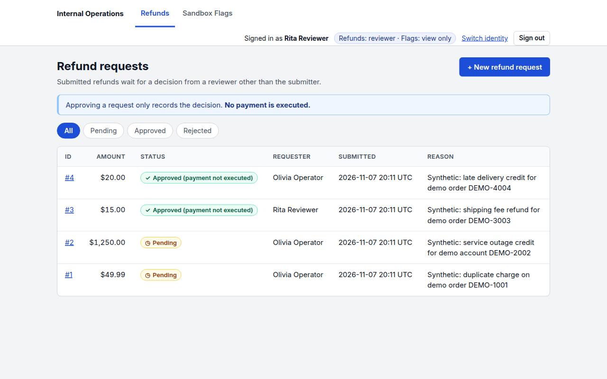
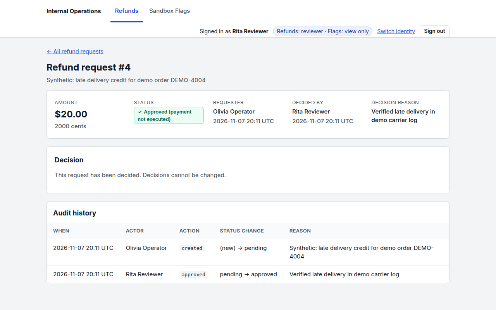
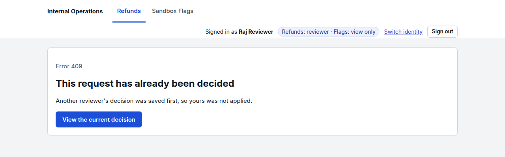
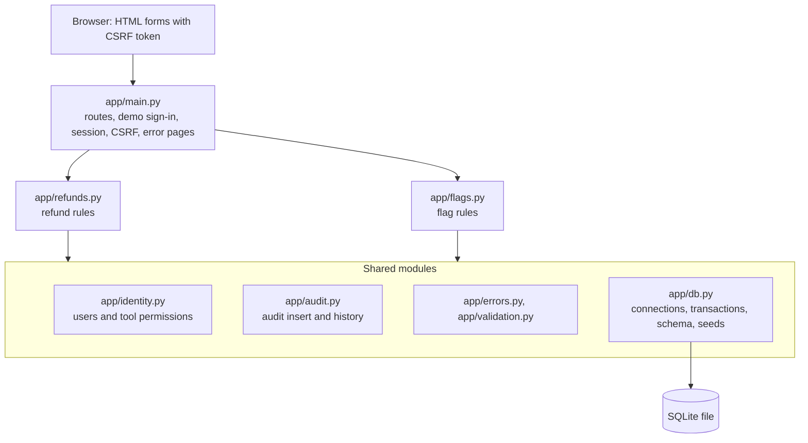

## Cognition Take-Home

This project explores how a fintech engineering team could use Devin to build internal tools currently served by Power Apps. It includes a refund approval workflow and a sandbox feature-flag panel, built in one application with shared sessions, permission checks, and audit utilities.

Refunds were the main workflow. I added flags to see what could be reused when building another tool.

> Local demo with synthetic data and simulated sign-in. Refund approvals do not move money, and flags do not control a live application.

## What this replicates from Power Apps (and what it doesn't)

Devin replaces the app builder, not the platform. Power Apps gives a team (a) a fast way to build forms-over-data apps and (b) a managed platform: Entra ID SSO, connectors, Dataverse, hosting, and admin governance (environments, DLP policies). Devin can replace (a). The company would own (b).

| Replicated here | Not replicated (on purpose) |
|---|---|
| Forms over data | Connectors |
| Server-side role and permission checks | Dataverse |
| Approval workflow with no self-approval | Citizen-developer building |
| Append-only audit trail (enforced by the app) | Managed hosting |
| Safe concurrent edits | DLP and environment governance |
| | Mobile app |

Refunds were chosen over KYC because KYC brings PII, an identity-verification vendor, and compliance review into scope. That makes it the worst app to start with and the last one to migrate.

There is no generic form builder. Rebuilding the Power Apps builder misses the point because Devin is the builder.

**Reuse result:** the flags tool added `app/flags.py` (83 lines), 2 tables (`feature_flags`, `tool_permissions`), 3 routes, 2 templates (69 lines), and 18 tests. It reused the session and CSRF handling, `db.connect` and `db.transaction`, the audit, error, and validation modules, the base layout, error page, and audit-table templates, and the test fixtures. The audit table needed one migration to add a `flag_id` column.

Target production design: [docs/architecture.md](docs/architecture.md). How the project was built: [docs/devin-workflow.md](docs/devin-workflow.md).

## Run locally

You need Python 3.10 or newer.

```bash
git clone https://github.com/SohanMads/fintech-internal-tools-poc.git
cd fintech-internal-tools-poc
python3 -m venv .venv
. .venv/bin/activate
pip install -r requirements-dev.txt

export DEMO_MODE=true
export SESSION_SECRET="$(python -c 'import secrets; print(secrets.token_hex(32))')"
uvicorn app.main:create_app --factory --host 127.0.0.1 --port 8000
```

Then open http://127.0.0.1:8000.

`DEMO_MODE=true` enables the demo sign-in page; without it every page returns 503. `SESSION_SECRET` signs the session cookie. Reuse the same value across restarts to keep users signed in; if unset, a random secret is generated and sessions reset on every restart.

On first start the app creates and seeds `refunds.db` in the current directory (override with `DATABASE_PATH`). To reset the demo data, stop the server and delete only that file and its SQLite side files:

```bash
rm -f refunds.db refunds.db-wal refunds.db-shm
```

## Try the workflows

Choose any seeded user on the sign-in page:

| User | Refunds | Sandbox Flags |
|---|---|---|
| Olivia Operator | Submit | View |
| Rita Reviewer | Submit; approve or reject others' requests | View |
| Raj Reviewer | Submit; approve or reject others' requests | View |
| Victor Viewer | View | View |
| Fiona Flag Admin | View | Enable or disable |

**Submit and review a refund**

1. As Olivia, open **Refunds** → **New refund request** and enter an amount such as `12.50` and a reason.
2. Switch to Rita, open the request, and approve or reject it with a reason. Approved requests read "Approved (payment not executed)".

**Competing reviewers**

1. As Olivia, submit a fresh request so it is pending.
2. Open it as Rita in one browser and as Raj in a private window.
3. Submit a decision in both. The first one saved wins; the other gets a 409 "already decided" page.







**Change a flag**

1. As Fiona, open **Sandbox Flags**, choose a flag, and enable or disable it with a reason. The change appears in its audit history.
2. Open the same flag in two tabs and save a change in the first. The second tab's form is now stale: submitting it returns 409 "This setting has changed" with a link to the flag's current state.

## How it works

One FastAPI process renders Jinja2 templates and stores data in one SQLite file. There is no JavaScript framework or external service.

**Prototype module layout**



**Server-side permissions.** The session identifies the user by ID; roles and tool permissions are loaded from the database. A viewer who adds `role=reviewer` to the submit form still gets 403, and an `actor_id` field sent by the browser is ignored when writing the audit record. All changes are POST forms with a per-session CSRF token.

**Conditional updates.** A refund decision only applies if the request is still pending and the reviewer did not submit it:

```sql
UPDATE refund_requests SET status = ?, decided_by = ?, decision_reason = ?, decided_at = ?
WHERE id = ? AND status = 'pending' AND submitted_by <> ?
```

If no row changes, the reviewer gets 409 (already decided) or 403 (own request). Flag forms carry a version number; the update uses `WHERE id = ? AND version = ?` and increments it, so an older form cannot overwrite a newer change.

**Atomic audit writes.** Each submission, decision, or flag change runs in one `BEGIN IMMEDIATE` transaction together with its audit insert. If the audit insert fails, the change rolls back.

Dollar amounts are parsed with integer arithmetic, so `12.50` becomes `1250` cents without floating point.

**What flags reused.** Flags use the same sign-in, session, CSRF checks, database helpers, error handling, layout, and test fixtures as refunds. Audit and error code had to move out of the refund module into shared modules. New work was the `feature_flags` and `tool_permissions` tables, `app/flags.py`, three routes, two templates, and tests.

**Audit schema tradeoff.** Each audit row points to a refund request or a flag through its own nullable foreign key, with a CHECK requiring exactly one. This keeps real relational references for both tools, but each new audited resource type needs a schema change; in SQLite that means a table rebuild. A generic `target_type`/`target_id` pair would avoid changing the audit table for each new resource type, but would lose direct foreign-key enforcement to the target records.

## Tests

```bash
python -m pytest -q
```

The 84 tests each use a temporary SQLite database. They cover:

- permissions for both tools, including no self-approval;
- competing decisions (sequential and concurrent) and stale flag forms;
- CSRF on every form, and GET never modifying data;
- audit records matching each change, and rollback when the audit insert fails;
- dollar parsing and input validation;
- the 503 response without `DEMO_MODE`;
- migrating the older refund-only audit table with history preserved.

GitHub Actions (`.github/workflows/tests.yml`) runs the same command on Python 3.10 for pull requests and pushes to `main`, with no secrets and no deployment.

## Limitations

- Sign-in is simulated, and any user can be impersonated.
- It runs as one local process on SQLite, with no deployment setup.
- No payment, ledger, or feature-flag integrations exist.
- The app never edits audit rows, but anyone with database file access can.
- Each new audited resource type requires an audit schema change.
- On narrow screens, tables scroll horizontally and rows grow tall; there is no stacked mobile layout.

Production use would require identity-provider integration, deployment and operations work, and a security review.

Build timeline, verification history, and more technical detail are in [docs/build-notes.md](docs/build-notes.md).
