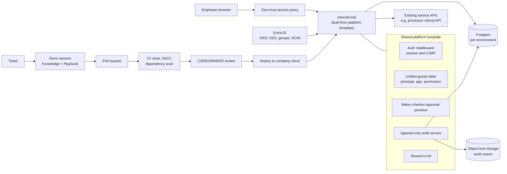

# Target production architecture

This describes what a real rollout would look like. It is not what the prototype does. The prototype is described in the [README](../README.md).

## Identity

Users sign in with Entra ID through OIDC SSO. The client already pays for Microsoft, so this adds no new identity vendor. Entra groups map to app permissions. SCIM deprovisioning removes access when someone leaves.

## Shared platform template

Every new app starts from one template repository. It contains:

- Auth middleware with session and CSRF handling.
- One unified grants table. Each row is a principal (user or group), an app, and a permission.
- An append-only audit service. It writes to Postgres with UPDATE and DELETE revoked from the app's database role. It also exports to object-lock storage so tampering is detectable.
- A reusable maker-checker approval primitive. One person submits, a different person approves.
- A shared UI kit.

## Data

Each environment has its own Postgres database. Internal tools never write directly to the production databases of money movement or KYC systems. They call existing service APIs instead. A refund approval would call the payment processor's refund API with an idempotency key.

## Network

Apps sit behind a zero-trust access proxy. They are not exposed to the public internet.

## CI/CD

Every pull request runs tests, SAST, and dependency scanning. CODEOWNERS review is required before merge. Merged changes deploy to the company's cloud.

## Devin loop

1. A ticket describes the tool or change.
2. A Devin session picks it up. It uses Knowledge for platform conventions and a "new internal tool" Playbook.
3. Devin opens a PR.
4. CI runs.
5. A human reviews and approves.
6. The change deploys.

After launch, Devin handles ongoing maintenance: dependency upgrades, migrations, and small changes. Each one goes through the same PR, CI, and review path.

## Prototype vs production

| Concern | Prototype | Production |
|---|---|---|
| Database | SQLite file | Postgres per environment |
| Identity | Demo identity picker | Entra ID SSO |
| Permissions | `users.role` column plus `tool_permissions` | Unified grants table |
| Audit | One nullable FK per audited resource | `target_type`/`target_id` once there are more than about 3 audited resource types, with target integrity enforced in app code and tests |
| Runtime | Local process | Containerized deploy behind the access proxy |
