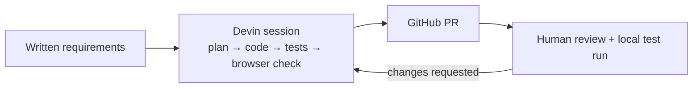

# Build notes

Supporting detail for the [README](../README.md): how the prototype was built, what was verified, and technical detail that is too granular for the README.

## Timeline and effort

- Devin session time, prototype start to PR #1 merge: 20 h 34 min of wall-clock time (2026-11-06 17:45 EST to 2026-11-07 14:19 EST). Most of it was the session waiting for the next request. Build work from start to the last application code push took 23 minutes (17:45 to 18:08 EST).
- Human time reviewing and directing: ~__ minutes

These numbers are from one session and are not an estimate for other apps.

### Development flow



CI: `.github/workflows/tests.yml` runs `python -m pytest -q` on Python 3.10 for pull requests and pushes to `main`. Tests use a temporary SQLite file per test and a fixed test session secret; no credentials or deployment.

## Verification history

### Tests

`python -m pytest -q` passed 84 tests locally and in a clean clone. The refund-only version had 35 tests.

| File | Covers |
|---|---|
| `test_permissions.py` | role rules, 503 without demo mode, client role/actor ignored, CSRF on every form, GET never mutates, 404s |
| `test_validation.py` | invalid dollar amounts and blank reasons rejected with no rows written; trimming; labels |
| `test_decisions_and_audit.py` | self-approval, sequential + threaded concurrent conflicts, audit consistency, audit-failure rollback, busy-timeout 503, DB constraints |
| `test_flags.py` | per-tool permission labels; stale-form 409 page links to the flag; everyone views; only Fiona edits (403 for others, 401 anonymous); Fiona cannot submit or decide refunds; reason required; CSRF; GET never mutates; stale form → 409; 404; audit-failure rollback; audit target CHECK |
| `test_money_and_migration.py` | exact dollar→cents conversion and rejects; refund-only audit table migrated with history preserved, idempotent |

### Reproducibility

**Reproducibility check:** a fresh `git clone` of the PR #1 branch into an empty directory, `python3 -m venv .venv`, `pip install -r requirements-dev.txt`, `python -m pytest -q` (84 passed), then `uvicorn` with `DEMO_MODE=true`, a generated `SESSION_SECRET` and a new `DATABASE_PATH`: `/login` 200, `/static/app.css` 200, anonymous `/requests` 303 to login, and without `DEMO_MODE` → 503. Checked on Ubuntu with Python 3.10.12.

### Browser check

**Browser check** (local Chromium against the running app): submitted `12.50` (stored 1250 cents) after `12.505` was rejected; Fiona saw no decision buttons and got 403 on the submit page; Rita approved and the queue showed "Approved — payment not executed."; Rita saw Sandbox Flags read-only; Fiona disabled a flag with a reason and the audit row appeared; a second Fiona tab with the older form got 409.

### CI

The `pytest` GitHub Actions check passed on the PR #1 commits `cc9bde0`, `ba21537` and `9c778e7`. The last of these is the head that was merged.

The `pytest` run on `main` passed after each merge: `8e947df` (PR #1) and `b6fcf22` (PR #2).

## Technical detail

### File layout

```
app/main.py        routes for both tools, demo identity, session + CSRF, error handling, nav context
app/db.py          connection setup, schema, audit migration, seeds, transaction helper
app/identity.py    server-side user and grant lookup
app/audit.py       shared audit insert + history query
app/errors.py      shared ServiceError hierarchy (status codes)
app/validation.py  shared reason validation
app/refunds.py     refund-only rules
app/flags.py       flag-only rules
app/templates/     base (Internal Operations nav), login, error, refund pages, flag pages
tests/             pytest suite
```

### Rules enforced on the server

- Refund amount is entered in dollars (`12.50`, `12.5`, `7`) and converted to integer cents with string/integer arithmetic only (no `float`, no binary floating point). Rejected: more than two decimals, `12.`, `.5`, signs, `$`, commas, exponents, zero, over $1,000,000.00. Stored as `amount_cents` INTEGER.
- Reasons (refund submissions, decisions, flag changes) are trimmed, non-blank, ≤ 1000 chars.
- Only reviewers decide, never on their own requests; a decision needs a reason and only changes a `pending` request.
- Flag changes need the `flags.edit` grant, a reason, and the flag `version` the form was rendered with; a mismatched version is **409** (stale form).
- Responses: **404** nonexistent request or flag, **403** forbidden action or bad CSRF token, **409** already decided / stale flag form, **422** validation error, **401** no identity on a POST, **503** + `Retry-After: 1` if the SQLite busy timeout (2 s) expires.
- All state-changing actions (submit, decide, change flag, choose identity, sign out) are `POST` forms with a per-session CSRF token (Starlette `SessionMiddleware` signed cookie + synchronizer token, compared with `secrets.compare_digest`). No `GET` request mutates anything.

### Schema

- `users(id, username UNIQUE, display_name, role CHECK IN (operator, reviewer, viewer))`
- `tool_permissions(user_id FK, permission CHECK IN ('flags.edit'), PK(user_id, permission))`
- `refund_requests(id, amount_cents CHECK integer > 0, reason CHECK trimmed non-blank, status CHECK IN (pending, approved, rejected), submitted_by FK, created_at, decided_by FK, decision_reason, decided_at)`
  - CHECK: pending ⇒ no decision fields; approved/rejected ⇒ reviewer, reason and timestamp all present.
  - CHECK: `decided_by <> submitted_by`.
- `feature_flags(id, key UNIQUE, name, description, enabled CHECK IN (0,1), version ≥ 1, updated_at, updated_by FK)`
- `audit_events(id, request_id FK NULL, flag_id FK NULL, actor_id FK, action, from_status, to_status, reason, created_at)`
  - CHECK: exactly one of `request_id` / `flag_id` is set, and the action matches the tool (`created/approved/rejected` for refunds, `flag_enabled/flag_disabled` for flags).

Foreign keys are enabled on every connection.

### Audit schema change and tradeoff

The refund-only `audit_events` had `request_id NOT NULL`. The change: make `request_id` nullable, add nullable `flag_id`, and add a CHECK that exactly one target is set. SQLite cannot relax `NOT NULL` in place, so `init_db` rebuilds the table once (create new → copy all rows with `flag_id = NULL` → drop → rename) in one transaction, verifies the row count and `PRAGMA foreign_key_check`, and rolls back if either fails. Existing ids and history are kept. This was checked on a test database and on the existing local demo database (7 refund audit rows before and after).

- **Why this:** one audit table and one `audit.record()` / `audit.history()` for both tools, with real foreign keys to each target table.
- **Cost:** this keeps real relational references for these two tools, but each additional audited resource type needs a schema change (a new nullable FK column, a wider CHECK, and a table rebuild in SQLite). It can support more tools; it just requires a migration for each one. Alternatives: a separate audit table per tool (no migration, but duplicated audit code), or a generic `target_type` + `target_id` pair (scales, but loses foreign-key enforcement). For two tools, the nullable-FK version was the smallest change that kept integrity checks.

### Audit history

The application only ever inserts into `audit_events`; it has no code path that updates or deletes audit rows. This is application behavior only — the table is **not** immutable or tamper-resistant against anyone with direct access to the SQLite file.

### What Sandbox Flags reused vs. newly implemented

**Reused unchanged or with small generalization:**
- Demo identity picker, session cookie, `DEMO_MODE` fail-closed middleware, sign-in/out.
- CSRF synchronizer token and `checked_form()`; `require_user()`.
- `db.connect()` (foreign keys, busy timeout), `transaction()` (`BEGIN IMMEDIATE`), `DatabaseBusy` → 503 handler.
- Audit insert/history (moved from refund code into `app/audit.py`, generalized with a `flag_id` target).
- Error classes and their 403/404/409/422 handler (moved to `app/errors.py`).
- Reason validation (moved to `app/validation.py`).
- Layout, banners, error page, `ts` timestamp filter, badge styles.
- Test fixtures: `app`, `conn`, `users`, `as_user`, `UserClient` (no changes needed for flags).

**New for Sandbox Flags:**
- `feature_flags` and `tool_permissions` tables, seeds (3 flags, Fiona + `flags.edit`), audit table migration.
- `app/identity.py` grant lookup (`has_permission`).
- `app/flags.py`: permission check, enable/disable, version-checked update + audit in one transaction.
- Three routes (`GET /flags`, `GET /flags/{id}`, `POST /flags/{id}`) and two templates.
- `tests/test_flags.py`, `tests/test_money_and_migration.py`.

**Shared changes made in the same pass:** "Internal Operations" navigation, status badges, readable timestamps, and dollar-amount refund input.

## Additional limitations

- Flag routes live in `app/main.py` next to refund routes. A third tool would justify splitting routes into separate modules.
- CI runs tests only, with no lint, coverage or deployment.
- No pagination, notifications, editing or withdrawal of requests, or UI for creating and deleting flags.
- Sandbox Flags has no SDK, targeting or rollout percentages, and nothing reads the flags.

## Production responsibilities still owned by the company

- Real authentication (SSO), authorization model and access reviews.
- Hosting, network exposure, TLS, secret management (`SESSION_SECRET`), backups and disaster recovery.
- Database choice, migrations process, data retention, and tamper-evident audit storage.
- Payment/ledger integration and financial controls, if any are ever connected.
- Security review, compliance sign-off, monitoring, incident response and on-call.
- Code review and ownership of everything Devin produces; CI and release process.

## Simulated vs. out of scope

- **Simulated:** login (identity picker, impersonation allowed), users, requests and flags (synthetic), approval (status change only, no money moves), flags (stored values only, nothing reads them).
- **Out of scope:** production SSO/authentication, real payment/processor/ledger integrations, public deployment, multi-instance concurrency (single SQLite file), microservices, a generic workflow builder, feature-flag SDKs/targeting/rollouts, notifications, editing/withdrawing requests, pagination.
